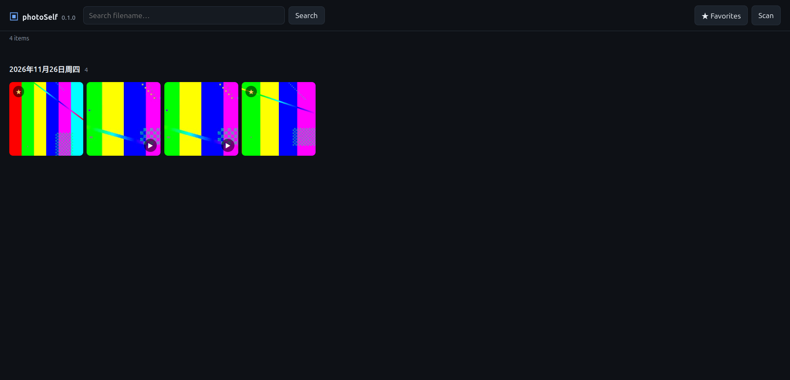

# photoSelf

[](https://github.com/shinvdu/photoSelf/actions/workflows/ci.yml)
[](#license)

A lightweight, config-driven, self-hosted photo and video gallery.

- **Backend:** Rust (single binary)
- **Frontend:** Vue 3 + Vite
- **Storage:** your existing folders; SQLite is only an index
- **Design:** read-only by default, low memory, reverse-proxy friendly
- **Status:** v0.1 MVP — browsing, thumbnails, video posters and favorites work; tags, albums, upload/delete and transcoding are next



The design document (Chinese) lives at [`docs/design.md`](docs/design.md).

---

## Why another gallery?

Most self-hosted galleries assume a powerful server and want to import your library. photoSelf is aimed at a different point:

- run on a **512 MB–2 GB** ARM box, NAS, mini PC or router;
- index **existing directories** without moving files;
- serve media through **Nginx / Caddy / lighttpd**, not through the app;
- keep the core **generic**; device-specific behavior is configuration;
- stay small enough to audit and easy to cross-compile.

---

## Features

### Working in v0.1

- Recursive scan of one or more libraries, with ignore globs
- Indexes JPEG/PNG/WebP/GIF/BMP/TIFF plus HEIC/HEIF/AVIF by extension
- Incremental metadata: size/mtime, EXIF date/camera/orientation, video probe via ffprobe
- Content hashes (BLAKE3) for stable thumbnails and rename detection
- Timeline grid grouped by day, lazy thumbnails, lightbox, video playback
- Image thumbnails and video poster frames (ffmpeg)
- Favorites
- Search by filename
- Manual scan with job progress
- `none` / `basic` / `proxy` authentication
- Standalone mode (Rust serves API, media and UI) or reverse-proxy mode
- Embedded-UI release build (optional feature)
- SQLite index with WAL; deleting the DB is safe — it rebuilds from files
- Graceful handling of missing files; `.DS_Store` / `._*` ignored by default

### Planned

- Tags and virtual albums
- Upload / delete / rename with a trash folder
- Background video transcoding queue
- Scheduled scans and thumbnail pre-warming
- Multi-user accounts and share links
- FTS search
- PWA / offline shell

---

## Quick start

Requirements: Rust 1.75+ (edition 2021), Node 20+, `ffmpeg`/`ffprobe` for video posters.

```bash
# 1. Build the UI
cd ui
npm install
npm run build
cd ..

# 2. Configure
cp config.example.toml config.toml
# edit config.toml: at least [[libraries]] path, listen address and data dir

# 3. Run
cargo run -p photoself-server -- serve -c config.toml
```

Open <http://127.0.0.1:8787/> and press **Scan**.

Useful commands:

```bash
photoself serve -c config.toml            # start server
photoself scan -c config.toml             # scan and exit
photoself scan -c config.toml --library family
photoself hash-password --password '...'  # Argon2id hash for auth.mode = "basic"
```

For a single-file release build with the UI embedded:

```bash
cargo build -p photoself-server --release --features embed-ui
# requires ui/dist to exist; output: target/release/photoself
```

---

## Configuration

See [`config.example.toml`](config.example.toml) for every option. The important parts:

```toml
[[libraries]]
id = "family"
name = "Family photos"
path = "/photos"
read_only = true
```

- `server.listen` — bind address, e.g. `127.0.0.1:8787` behind a proxy or `0.0.0.0:8787` on a trusted LAN.
- `data.dir` — SQLite, thumbnail cache and temporary files.
- `media.serve_mode` — `standalone` (this server serves media) or `proxy` (Nginx/lighttpd serves `/media` and `/thumbs`).
- `auth.mode` — `none`, `basic` (single user, Argon2id), or `proxy` (trust `X-Forwarded-User`).
- `thumbnails.concurrency` — keep `1` on 512 MB devices.
- `scan.hash` — content hashing enables rename detection and stable thumbnails; disable only for very slow storage.

### Pre-generated previews (HEIC / HEVC on low-power devices)

OpenWrt's ffmpeg package often has no software HEVC/HEIF decoder, and iPhones
sometimes store HEIC files with a `.JPG` name. Generate previews on a PC/NAS
and let photoSelf serve them directly:

```bash
# source can be a local folder, NFS/SMB mount, or sshfs
./scripts/make-sidecars.py \
  --source /mnt/router/picture \
  --output /mnt/router/sda1/photo-app/sidecars/family \
  --sizes 320,1280 --video-sizes 320 --jobs 2

# add to config.toml
[thumbnails]
sidecar_dir = "/mnt/usb/photo-app/sidecars"
```

The output directory should be `<sidecar_dir>/<library-id>/`. The script writes
`<relative-path>.<size>.jpg` and `<relative-path>.meta.json`
(width/height/duration/date). Existing thumbnails are skipped unless `--force`;
`--meta-only` refreshes only metadata. Requirements: Python 3 + Pillow,
ffmpeg/ffprobe, and `heif-convert` (libheif-examples) for HEIC.

### Low-memory profile

```toml
[thumbnails]
sizes = [320]
concurrency = 1

[ffmpeg]
concurrency = 1

[video]
transcode_enabled = false

[scan]
on_start = false
concurrency = 1
```

---

## HTTP API (v0.1)

Base path: `/api/v1`. Errors use `application/problem+json`.

| Method | Path | Purpose |
|---|---|---|
| GET | `/healthz` | liveness (unauthenticated) |
| GET | `/api/v1/info` | version, mode, libraries, counts |
| GET | `/api/v1/items` | timeline; `library`, `kind`, `q`, `favorite`, `from`, `to`, `cursor`, `limit` |
| GET | `/api/v1/items/{id}` | item detail |
| PATCH | `/api/v1/items/{id}` | `{ "favorite": true }` |
| GET | `/api/v1/items/{id}/thumb/{size}` | JPEG thumbnail |
| GET | `/api/v1/items/{id}/media` | original media, supports HTTP Range |
| POST | `/api/v1/scan` | start a scan job |
| GET | `/api/v1/jobs` | recent jobs |
| GET | `/api/v1/jobs/{id}` | job status/progress |

List responses use cursor pagination:

```json
{ "items": [ ... ], "next_cursor": "..." }
```

---

## Deployment

### Docker

```bash
docker build -t photoself .
docker run -d --name photoself \
  -p 8787:8787 \
  -v /srv/photos:/photos:ro \
  -v photoself-data:/data \
  -v "$PWD/config.docker.toml:/data/config.toml:ro" \
  photoself
```

Start from [`deploy/docker/config.example.toml`](deploy/docker/config.example.toml) and
copy it to `config.docker.toml`. The image includes ffmpeg for video posters.

The Dockerfile uses `public.ecr.aws/docker/library/*`, an AWS-hosted mirror of the
official Docker Hub images, which is often reachable when `registry-1.docker.io`
is not. If `npm ci`, `cargo` or `apt-get` need a proxy, build with:

```bash
docker build --network=host \
  --build-arg HTTP_PROXY=http://127.0.0.1:1081 \
  --build-arg HTTPS_PROXY=http://127.0.0.1:1081 \
  -t photoself .
```

(`--network=host` makes `127.0.0.1` inside the build container refer to the
host; without it, use your Docker bridge address such as `172.17.0.1`.)

### systemd

See [`deploy/systemd/photoself.service`](deploy/systemd/photoself.service). It assumes:

- binary: `/usr/local/bin/photoself`
- config: `/etc/photoself/config.toml`
- data: `/var/lib/photoself`
- photos: `/photos` (read-only)

### OpenWrt / low-power Linux

A typical low-memory deployment:

1. Build a static ARM64 binary (SQLite bundled needs a C cross compiler; `cargo-zigbuild` works):

   ```bash
   rustup target add aarch64-unknown-linux-musl
   cargo install cargo-zigbuild --locked
   cd ui && npm ci && npm run build && cd ..
   cargo zigbuild --release --target aarch64-unknown-linux-musl \
     -p photoself-server --features embed-ui
   ```

2. Install:

   ```sh
   # Optional: OpenWrt ffmpeg can demux but often cannot *decode* HEVC.
   # For HEIC/HEVC libraries, generate sidecar previews on a PC instead.
   opkg install ffmpeg ffprobe        # optional; poster fallback for supported codecs
   scp target/aarch64-unknown-linux-musl/release/photoself root@router:/usr/bin/photoself
   scp config.example.toml root@router:/etc/photoself/config.toml
   scp deploy/openwrt/photoself.init root@router:/etc/init.d/photoself
   ssh root@router 'chmod +x /etc/init.d/photoself; /etc/init.d/photoself enable; /etc/init.d/photoself start'
   ```

3. Put config, SQLite and thumbnails on USB storage (`data.dir`), and keep only the binary/config on NAND. Set `thumbnails.concurrency = 1`, `ffmpeg.concurrency = 1`, `video.transcode_enabled = false`.

4. Put lighttpd/Nginx in front for TLS, auth and media serving. See
   [`deploy/lighttpd/94-photoself.conf`](deploy/lighttpd/94-photoself.conf) for a lighttpd example;
   the design doc has a detailed config walkthrough.

Example OpenWrt config (paths are configuration, not code):

```toml
[server]
mode = "reverse-proxy"
listen = "127.0.0.1:8787"

[data]
dir = "/mnt/usb/photo-app/data"

[[libraries]]
id = "family"
path = "/mnt/photos"
read_only = true

[media]
serve_mode = "proxy"
public_media_path = "/photo/media"
public_thumb_path = "/photo/thumbs"

[thumbnails]
sizes = [320, 1280]
concurrency = 1

[ffmpeg]
concurrency = 1

[video]
transcode_enabled = false

[auth]
mode = "proxy"

[scan]
on_start = false
```

### Reverse proxy notes

- `auth.mode = "proxy"`: the proxy must authenticate and set `X-Forwarded-User`.
- `media.serve_mode = "proxy"`: the proxy must map
  `/media/<library-id>/<relative-path>` to the library root, and
  `/thumbs/...` to `data/cache/thumbs/...`.
- Media URLs are content-addressed for thumbnails; long cache headers are safe.
- Do **not** expose the app directly to the internet without auth and TLS.

---

## Project layout

```text
photoSelf/
├── crates/
│   ├── photoself-core/     # config, SQLite, scanner, metadata, thumbnails
│   └── photoself-server/   # axum API, auth, static UI, CLI
├── ui/                     # Vue 3 + Vite SPA
├── deploy/                 # systemd, procd, nginx, lighttpd
├── docs/                   # design doc + screenshot
├── config.example.toml
├── scripts/
│   └── make-sidecars.py    # HEIC/HEVC preview generation for low-power devices
├── Dockerfile
└── .github/workflows/ci.yml
```

## Development

```bash
cargo fmt --all
cargo clippy --workspace --all-targets -- -D warnings
cargo test --workspace

# UI dev server (proxies /api to 127.0.0.1:8787)
cd ui && npm install && npm run dev
```

Testing uses synthetic images/videos generated with ffmpeg; no personal data is required.

---

## Status and known limitations

This is a **v0.1 MVP**, not a finished product:

- Tags, albums, upload/delete, trash restore and share links are not wired yet.
- Video is played as-is; no transcoding. MOV/HEVC compatibility depends on the browser.
- Reserved/not fully enforced yet: `scan.interval`, `scan.concurrency`, `ffmpeg.concurrency`,
  `missing_retention_days`, `thumbnails.prewarm_on_scan`, `video.transcode_enabled`,
  `video.max_height`, `trash.*`, `auth.session_ttl_hours`, `server.base_path`, `server.ui_embedded`
  and `server.trusted_proxies`.
- `auth.mode = "proxy"` trusts `X-Forwarded-User`; only use it behind a trusted proxy that
  strips client-supplied headers.
- EXIF dates without timezone are stored as naive local timestamps.
- HEIC/RAW are indexed but thumbnails may fail unless ffmpeg supports them.
- SQLite is compiled with `bundled`; cross builds need a C compiler (use zigbuild or the OpenWrt SDK).
- The embedded UI feature must be built after `ui/dist` exists.

## Roadmap

- **v0.2:** tags, albums, upload/delete with trash, search filters
- **v0.3:** video derivatives/transcode queue, scheduled scans, PWA
- **v1.0:** stable API, migrations, packaging, security review

## Design

- [`docs/design.md`](docs/design.md) — architecture, data model, API, deployment, risks (Chinese)

## License

Licensed under either of:

- Apache License, Version 2.0 ([LICENSE-APACHE](LICENSE-APACHE))
- MIT license ([LICENSE-MIT](LICENSE-MIT))

at your option.

`ffmpeg` is **not** bundled in the Rust binary or release archive. It is an optional external
program; if you bundle it in a container or distribution, respect its LGPL/GPL obligations.
