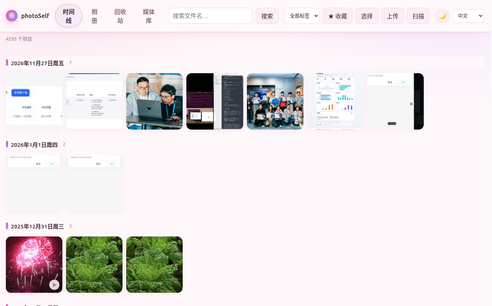

# photoSelf

[English](README.md) | 简体中文

[](https://github.com/shinvdu/photoSelf/actions/workflows/ci.yml)
[](#许可证)
[](https://github.com/shinvdu/photoSelf/releases)

一个轻量、配置驱动、自托管的照片与视频画廊。

- **后端：** Rust 单二进制
- **前端：** Vue 3 + Vite
- **存储：** 直接使用现有目录；SQLite 只是可重建的索引
- **设计：** 默认只读、低内存、对反向代理友好
- **状态：** v0.2 —— 浏览、标签、相册、上传/删除+回收站、网页版视频队列、定时扫描和 PWA



详细技术设计（中文）：[`docs/design.md`](docs/design.md)

---

## 文档

- [安装文档](docs/installation.zh-CN.md) · [English](docs/installation.md)
- [使用说明](docs/usage.zh-CN.md) · [English](docs/usage.md)
- [本地开发环境](docs/local-development.md)（中文）
- [AI 安装提示词](docs/ai-install-prompt.zh-CN.md) · [English](docs/ai-install-prompt.md)
- [全部文档](docs/README.md)
- [技术设计](docs/design.md)
- [OpenWrt 说明](deploy/openwrt/README.md)
- [贡献指南](CONTRIBUTING.md) · [安全说明](SECURITY.md)

## 为什么还要另一个画廊？

大多数自托管画廊假设你有性能充足的服务器，并且要求把照片导入它们的库。photoSelf 的定位不同：

- 可以在 **512 MB–2 GB** 的 ARM 盒子、NAS、迷你主机、路由器上运行；
- 直接索引**已有目录**，不搬动、不导入；
- 媒体文件由 **Nginx / Caddy / lighttpd** 提供，不经过应用转发；
- 核心保持**通用**；设备差异通过配置处理；
- 代码量小、易审计、易交叉编译。

---

## 功能

### v0.2 已实现

- 递归扫描一个或多个库，支持忽略规则
- 文件大小/mtime、EXIF 日期/相机/方向、ffprobe 视频元数据
- 支持 JPEG/PNG/WebP/GIF/BMP/TIFF，以及 HEIC/HEIF/AVIF 扩展名
- BLAKE3 内容哈希：稳定缩略图、重命名识别
- 时间线分组、懒加载缩略图、灯箱、视频播放
- 图片缩略图、视频海报（ffmpeg 外部进程）
- 收藏、文件名搜索
- 手动扫描 + 定时扫描（`scan.interval`，如 `15m`）
- 标签：创建/删除、挂载/移除、按标签筛选
- 相册：创建/删除、添加/移除条目、封面
- 上传、删除到回收站、恢复和永久清除（写入模式）
- 后台 web MP4 转码队列 + 任务状态（`play_url`）
- PWA / 可安装的离线壳
- 界面多语言（简体中文 / 英文，默认中文）
- 灯箱缩放/拖动（滚轮、双指、双击、按钮），放大后加载原图；竖屏界面使用可收起的信息/操作底栏 + 左右滑动切换
- 柔和的浅色/深色主题（首次跟随系统，顶部可切换并记住选择）
- 可选界面媒体库管理：添加/停用/移除目录、单库扫描，服务端目录选择器限定在白名单内
- `none` / `basic` / `proxy` 三种认证
- 独立模式（Rust 同时提供 API、媒体、UI）或反向代理模式
- 可选 `embed-ui` 特性：前端嵌入单二进制
- SQLite WAL 索引；删除数据库可安全重建
- Sidecar 预生成预览与元数据（适合 HEIC/HEVC 低功耗设备）
- 未变化文件复用哈希，重新扫描几乎不重复读全库

### 计划中

- 多用户与分享链接
- 全文搜索
- 重命名/移动 UI、缩略图预热
- 回收站自动过期清理

---

## 快速开始

需要：Rust stable（本项目在 1.97 上测试）、Node 20+，视频海报需要 `ffmpeg`/`ffprobe`。

```bash
# 1. 构建前端
cd ui
npm install
npm run build
cd ..

# 2. 配置
cp config.example.toml config.toml
# 至少修改 [[libraries]].path、server.listen、data.dir

# 3. 运行
cargo run -p photoself-server -- serve -c config.toml
```

打开 <http://127.0.0.1:8787/>，点击 **Scan**。

常用命令：

```bash
photoself serve -c config.toml            # 启动服务
photoself scan -c config.toml             # 扫描后退出
photoself scan -c config.toml --library family
photoself hash-password --password '...'  # 生成 Argon2id 哈希
```

预编译二进制（x86_64 / aarch64 / armv7）和 OpenWrt `.ipk` 安装包见 [Releases](https://github.com/shinvdu/photoSelf/releases)。

单文件发布（前端嵌入）：

```bash
cargo build -p photoself-server --release --features embed-ui
# 需要先存在 ui/dist；产物：target/release/photoself
```

---

## 用 AI 安装

把下面的提示词复制到 Claude Code、Cursor 或其他编码 Agent：

```text
从 https://github.com/shinvdu/photoSelf 安装 photoSelf。
先阅读 docs/installation.zh-CN.md 和 docs/usage.zh-CN.md。

先问我：安装方式（源码/Docker/OpenWrt）、照片库路径、可写数据目录、
端口/反向代理、认证方式，以及是否需要 HEIC/HEVC sidecar。
照片库必须保持只读，绝不能移动或删除照片。

构建并启动服务，执行一次扫描，验证 /healthz 和一张缩略图，
然后汇报 URL、服务名、数据目录、库 ID 和扫描结果。
```

完整提示词与安全规则：[`docs/ai-install-prompt.zh-CN.md`](docs/ai-install-prompt.zh-CN.md)。

## 配置

完整字段见 [`config.example.toml`](config.example.toml)。最关键的部分：

```toml
[[libraries]]
id = "family"
name = "Family photos"
path = "/photos"
read_only = true
```

- `server.listen` —— 绑定地址；反向代理后面用 `127.0.0.1:8787`，可信局域网可用 `0.0.0.0:8787`
- `data.dir` —— SQLite、缩略图缓存、临时文件
- `media.serve_mode` —— `standalone`（本进程提供媒体）或 `proxy`（反向代理提供 `/media`、`/thumbs`）
- `auth.mode` —— `none`、`basic`（单用户，Argon2id）、`proxy`（只信任 `server.trusted_proxies` 网段发来的 `X-Forwarded-User`）
- `thumbnails.concurrency` —— 512 MB 设备建议 `1`
- `scan.hash` —— 内容哈希用于重命名识别；只有极慢存储才建议关闭
- `scan.interval` —— 定时扫描，如 `15m`、`1h`；`0` 关闭
- `[write] enabled` —— 上传/删除/回收站；目标库还需要 `read_only = false`
- `video.transcode_enabled` —— 可选的 web MP4 队列（需要带编码器的 ffmpeg）

### 低内存配置

```toml
[thumbnails]
sizes = [320]
concurrency = 1

[ffmpeg]
concurrency = 1

[video]
transcode_enabled = false

[scan]
on_start = false
concurrency = 1
```

### 预生成预览（低功耗设备上的 HEIC / HEVC）

OpenWrt 的 ffmpeg 往往没有软件 HEVC/HEIF 解码器；iPhone 还可能把 HEIC 文件命名为 `.JPG`。可以在 PC/NAS 上预生成预览，photoSelf 直接读取：

```bash
# source 可以是本地目录、NFS/SMB 挂载或 sshfs
./scripts/make-sidecars.py \
  --source /mnt/router/picture \
  --output /mnt/router/usb/photo-app/sidecars/family \
  --sizes 320,1280 --video-sizes 320 --jobs 2

# 每个库一个子目录：<sidecar_dir>/<library-id>/
```

```toml
[thumbnails]
sidecar_dir = "/mnt/usb/photo-app/sidecars"
```

脚本会写出 `<relative-path>.<size>.jpg` 和 `<relative-path>.meta.json`
（宽高/时长/拍摄时间）。已存在的缩略图默认跳过，可用 `--force` 强制；
`--meta-only` 只补元数据。依赖：Python 3 + Pillow、ffmpeg/ffprobe、
`heif-convert`（libheif-examples）。

视频默认播放原文件；HEVC 在 Safari/Apple 设备上通常可播。
开启 `video.transcode_enabled` 后，可在灯箱中为单个视频生成 web MP4（H.264/AAC）。

---

## HTTP API（v0.2）

前缀：`/api/v1`。错误返回 `application/problem+json`。

| 方法 | 路径 | 说明 |
|---|---|---|
| GET | `/healthz` | 存活检查（无需认证） |
| GET | `/api/v1/info` | 版本、模式、库、条目数 |
| GET | `/api/v1/items` | 时间线；`library`、`kind`、`q`、`favorite`、`tag`、`album`、`from`、`to`、`cursor`、`limit` |
| GET | `/api/v1/items/{id}` | 条目详情（含标签和 `play_url`） |
| PATCH | `/api/v1/items/{id}` | `{ "favorite": true }` |
| DELETE | `/api/v1/items/{id}` | 移入回收站（写入模式） |
| GET/POST | `/api/v1/tags` | 列出/创建标签 |
| DELETE | `/api/v1/tags/{id}` | 删除标签 |
| POST/DELETE | `/api/v1/items/{id}/tags[/{tag_id}]` | 挂载/移除标签 |
| GET/POST | `/api/v1/albums` | 列出/创建相册 |
| GET/DELETE | `/api/v1/albums/{id}` | 相册详情/删除 |
| GET/POST | `/api/v1/albums/{id}/items` | 列出/添加相册条目 |
| DELETE | `/api/v1/albums/{id}/items/{item_id}` | 从相册移除 |
| POST | `/api/v1/upload` | multipart 上传（`library`、`file`） |
| GET | `/api/v1/trash` | 回收站列表 |
| POST/DELETE | `/api/v1/trash/{id}[/restore]` | 恢复或永久清除 |
| POST | `/api/v1/items/{id}/transcode` | 排队生成 web MP4 |
| GET | `/api/v1/items/{id}/derived` | 提供 web MP4（支持 Range） |
| GET | `/api/v1/items/{id}/thumb/{size}` | JPEG 缩略图 |
| GET | `/api/v1/items/{id}/media` | 原文件，支持 HTTP Range |
| POST | `/api/v1/scan` | 启动扫描任务 |
| GET | `/api/v1/jobs` | 最近任务 |
| GET | `/api/v1/jobs/{id}` | 任务状态/进度 |

列表使用游标分页：

```json
{ "items": [ ... ], "next_cursor": "..." }
```

---

## 部署

### Docker

```bash
docker build -t photoself .
docker run -d --name photoself \
  -p 8787:8787 \
  -v /srv/photos:/photos:ro \
  -v photoself-data:/data \
  -v "$PWD/config.docker.toml:/data/config.toml:ro" \
  photoself
```

从 [`deploy/docker/config.example.toml`](deploy/docker/config.example.toml) 复制
`config.docker.toml`。镜像包含 ffmpeg，用于视频海报。

Dockerfile 使用 `public.ecr.aws/docker/library/*`（官方镜像的 AWS Public ECR
镜像源），在 `registry-1.docker.io` 不可达时通常仍可用。若构建容器需要代理：

```bash
docker build --network=host \
  --build-arg HTTP_PROXY=http://127.0.0.1:1081 \
  --build-arg HTTPS_PROXY=http://127.0.0.1:1081 \
  -t photoself .
```

### systemd

见 [`deploy/systemd/photoself.service`](deploy/systemd/photoself.service)。默认假设：

- 程序：`/usr/local/bin/photoself`
- 配置：`/etc/photoself/config.toml`
- 数据：`/var/lib/photoself`
- 照片：`/photos`（只读）

### OpenWrt / 低功耗 Linux

1. 交叉编译静态 ARM64 二进制（SQLite bundled 需要 C 交叉编译器，`cargo-zigbuild` 可用）：

   ```bash
   rustup target add aarch64-unknown-linux-musl
   cargo install cargo-zigbuild --locked
   cd ui && npm ci && npm run build && cd ..
   cargo zigbuild --release --target aarch64-unknown-linux-musl \
     -p photoself-server --features embed-ui
   ```

2. 安装：

   ```sh
   # 可选：OpenWrt ffmpeg 可以解封装，但通常不能解码 HEVC；
   # HEIC/HEVC 库建议在 PC 上生成 sidecar 预览。
   opkg install ffmpeg ffprobe
   scp target/aarch64-unknown-linux-musl/release/photoself root@router:/usr/bin/photoself
   scp config.example.toml root@router:/etc/photoself/config.toml
   scp deploy/openwrt/photoself.init root@router:/etc/init.d/photoself
   ssh root@router 'chmod +x /etc/init.d/photoself; /etc/init.d/photoself enable; /etc/init.d/photoself start'
   ```

3. 把配置、SQLite、缩略图放在 USB 存储（`data.dir`），NAND 上只放二进制/配置。
   设置 `thumbnails.concurrency = 1`、`ffmpeg.concurrency = 1`、
   `video.transcode_enabled = false`。

4. 前面放 lighttpd/Nginx 做 TLS、认证和媒体服务。示例：
   [`deploy/lighttpd/94-photoself.conf`](deploy/lighttpd/94-photoself.conf)；
   更多说明见 [`deploy/openwrt/README.md`](deploy/openwrt/README.md)。

### 反向代理注意事项

- `auth.mode = "proxy"`：代理必须完成认证并设置 `X-Forwarded-User`。
- `media.serve_mode = "proxy"`：代理需要把 `/media/<library-id>/<relative-path>`
  映射到库根目录，把 `/thumbs/...` 映射到 `data/cache/thumbs/...`。
- 缩略图 URL 带内容哈希，可放心使用长缓存。
- 不要把应用直接暴露到公网；必须启用认证和 TLS。

---

## 项目结构

```text
photoSelf/
├── crates/
│   ├── photoself-core/     # 配置、SQLite、扫描、元数据、缩略图
│   └── photoself-server/   # axum API、认证、静态 UI、CLI
├── ui/                     # Vue 3 + Vite SPA
├── deploy/                 # systemd、procd、nginx、lighttpd、Docker 配置
├── docs/                   # 安装、使用、AI 提示词、设计文档、截图
├── scripts/
│   └── make-sidecars.py    # 低功耗设备的 HEIC/HEVC 预览生成
├── config.example.toml
├── Dockerfile
└── .github/workflows/ci.yml
```

## 开发

```bash
cargo fmt --all -- --check
cargo clippy --workspace --all-targets -- -D warnings
cargo test --workspace

# UI 开发服务器（/api 代理到 127.0.0.1:8787）
cd ui && npm install && npm run dev
```

测试只用 ffmpeg 生成的合成图片/视频，不需要个人照片。

---

## 状态与已知限制

这是 **v0.2 MVP**，不是完成品：

- 写入模式（上传/删除/回收站）默认关闭；请显式开启，并让 API 处于认证之后。
  只有需要写入时才让照片库可写。
- 视频默认播放原文件；生成 web MP4 后才能在所有浏览器中播放，且取决于 ffmpeg
  是否支持对应解码/编码。
- 回收站保留期不会自动清理，需要手动清除旧条目。
- 保留/未完全强制的字段：`scan.concurrency`、`missing_retention_days`、
  `thumbnails.prewarm_on_scan`、`auth.session_ttl_hours`、`server.base_path`、
  `server.ui_embedded`。
- `auth.mode = "proxy"` 只信任来自 `server.trusted_proxies` 网段的
  `X-Forwarded-User`；仍应放在会清理客户端头的可信代理后面。
- 无时区的 EXIF 日期按本地裸时间存储。
- HEIC/RAW 可被索引；缩略图依赖 sidecar 或带相应解码器的 ffmpeg。
- SQLite 使用 `bundled` 编译；交叉编译需要 C 编译器（zigbuild 或 OpenWrt SDK）。
- `embed-ui` 特性需要在 `ui/dist` 存在后再编译。

## 路线图

- **v0.2/v0.3（当前）：** 标签、相册、上传/删除 + 回收站、搜索过滤、
  web MP4 队列、定时扫描、PWA
- **下一步：** 多用户/分享链接、全文搜索、重命名/移动、回收站自动过期
- **v1.0：** 稳定 API、迁移、打包、安全审计

## 设计文档

- [`docs/design.md`](docs/design.md) —— 架构、数据模型、API、部署与风险（中文）

## 许可证

本项目采用双许可，任选其一：

- Apache License, Version 2.0（[LICENSE-APACHE](LICENSE-APACHE)）
- MIT License（[LICENSE-MIT](LICENSE-MIT)）

`ffmpeg` **不包含**在 Rust 二进制或发布归档中，它是可选的外部程序；如果你在容器
或发行版中打包 ffmpeg，请遵守其 LGPL/GPL 义务。
